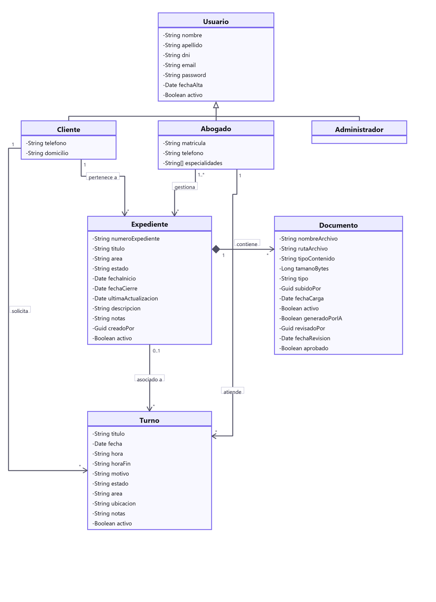

# LegalManager — Sistema de Gestión Integral para Estudios Jurídicos

> **Trabajo Práctico Integrador**  
> **Carrera:** Tecnicatura Universitaria en Programación (TUP)  
> **Cátedra:** Programación IV  
> **Equipo de Desarrollo:**  
> - Agustín Angelini  
> - Franco Cuscianna  
> - Thiago Cuscianna  
>
> 🌐 **Despliegue en la Nube (Microsoft Azure):**  
> - **API REST (Punto de acceso público):** [https://legalmanager-api-f4gqhqfsejdshrcm.chilecentral-01.azurewebsites.net](https://legalmanager-api-f4gqhqfsejdshrcm.chilecentral-01.azurewebsites.net)  
> - **Cliente Web (Frontend SPA):** [https://www.legalmanager.tech](https://www.legalmanager.tech)  

---

## 1. Descripción y Función Principal

**LegalManager** es una solución de software compuesta por una API REST y una aplicación cliente web, concebida para la gestión operativa y administrativa integral de un estudio jurídico. Centraliza y digitaliza los procesos centrales del ejercicio profesional del derecho:

1. **Gestión de Expedientes (Causas Legales):** Registro y seguimiento de casos judiciales y extrajudiciales, vinculación obligatoria entre clientes y abogados responsables, trazabilidad de actuaciones y control de ciclo de vida (Activo, Pendiente, Cerrado).
2. **Agenda y Turnos Profesionales:** Coordinación interactiva de citas con validación de disponibilidad horaria en tiempo real, detección de solapamientos a nivel de base de datos y cálculo de estados efectivos (`Finalizado`).
3. **Gestión Documental y Resúmenes con Inteligencia Artificial:** 
   - Subida y almacenamiento seguro de archivos PDF vinculados a cada causa (en Azure Blob Storage o en el sistema de archivos del servidor).
   - Generación de constancias oficiales formateadas profesionalmente con **QuestPDF**.
   - Redacción asistida de resúmenes de causas mediante **modelos de lenguaje (LLM)** a través de una arquitectura asincrónica y resiliente con **Polly**, bajo un esquema de confirmación previa (*confirm-first*).

---

## 2. Minuta de Relevamiento

### Roles de Usuario y Matriz de Permisos
El sistema implementa autenticación basada en **JSON Web Tokens (JWT)** con autorización por roles:

- **Administrador (Admin):** Propietario o director del estudio. Gestiona usuarios, asigna roles, audita expedientes y administra la configuración global.
- **Abogado (Lawyer):** Profesional a cargo de causas. Puede gestionar sus expedientes asignados, adjuntar y consultar documentos, coordinar su agenda y generar resúmenes con IA.
- **Cliente (Client):** Usuario final que consulta el avance de sus causas, descarga documentación pública y solicita turnos de atención.

| Funcionalidad / Módulo | Administrador | Abogado | Cliente |
|---|:---:|:---:|:---:|
| **Administración de Usuarios y Roles** | ✅ Sí | ❌ No | ❌ No |
| **Autorregistro inicial** | ❌ No | ❌ No | ✅ Sí (público) |
| **Creación de Expedientes** | ✅ Sí | ✅ Sí | ❌ No |
| **Gestión de Abogados en Causa** | ✅ Sí | ✅ Sí (asignados) | ❌ No |
| **Cambio de Estado de Causa** | ✅ Sí | ✅ Sí (asignados) | ❌ No |
| **Consulta de Expedientes** | ✅ Todos | 👁️ Solo asignados | 👁️ Solo propios |
| **Solicitud de Turnos** | ✅ Sí | ✅ De sus clientes | ✅ Solo propios |
| **Gestión de Agenda (Confirmar/Cancelar)** | ✅ Sí | ✅ Su agenda | 👁️ Solo cancelar propio |
| **Subida y Descarga de Documentos PDF** | ✅ Sí | ✅ De sus expedientes | 👁️ Descarga de propios |
| **Generación de Resumen IA y Constancias** | ✅ Sí | ✅ Sí | ❌ No |

### Reglas de Negocio
- **Baja Lógica Universal:** Ninguna entidad se elimina de forma física en base de datos; todas implementan la propiedad `Active = false` para auditoría y consistencia histórica.
- **Unicidad de Identificadores:** El DNI (con normalización de formato argentino), Email y Número de Expediente son estrictamente únicos.
- **Integridad de Expedientes:** Toda causa debe contar con un cliente titular y al menos un abogado responsable. No es posible desvincular al último abogado.
- **Congelamiento de Casos Cerrados:** Un expediente en estado Cerrado no admite modificaciones, reaperturas ni la adición de nuevos documentos adjuntos.
- **Agenda sin Solapamiento:** Protección a doble nivel contra doble reserva: validación lógica en memoria y constraint única filtrada en base de datos (`UX_Appointments_Lawyer_Slot`).
- **Seguridad en Cuentas:** Tokens de confirmación de email (24 h) y recuperación de contraseña (1 h) protegidos mediante hash SHA-256 de un solo uso. Revocación inmediata en `OnTokenValidated` para usuarios inactivos o no confirmados.

---

## 3. Diagrama de Clases

<div align="center">
  
</div>

---

## 4. Arquitectura y Diseño del Sistema

### A. Patrón Clean Architecture
El sistema está construido en 4 proyectos desacoplados con flujo unidireccional de dependencias hacia el núcleo del dominio:

```
┌────────────────────────────────────────────────────────┐
│                     Presentation                       │
│   (Controllers, Auth Policies, Middlewares, DI Setup)  │
└───────────────────────────┬────────────────────────────┘
                            │
┌───────────────────────────▼────────────────────────────┐
│                      Application                       │
│   (Use Cases, Services, DTOs, Service Interfaces)      │
└─────────────┬────────────────────────────┬─────────────┘
              │                            │
┌─────────────▼─────────────┐ ┌────────────▼─────────────┐
│           Domain          │ │      Infrastructure      │
│ (Entities, Enums, Rules,  │ │ (EF Core, TPC, Repos,    │
│  Value Objects, Ports)    │ │  Blob Storage, AI Polly) │
└───────────────────────────┘ └──────────────────────────┘
```

- **`LegalManager.Domain`:** Núcleo sin dependencias de frameworks externos. Contiene las entidades con lógica de negocio encapsulada (`Entities/`), tipos enumerados (`Enums/`), objetos de valor y reglas de validación como `FieldLengths` y `DniFormat` (`ValueObjects/`), excepciones de dominio (`Exceptions/`) e interfaces de abstracción (`Interfaces/`).
- **`LegalManager.Application`:** Orquesta los casos de uso organizada por módulos funcionales (`Auth/`, `Users/`, `Cases/`, `Appointments/`, `Documents/`). Cada módulo cuenta con sus contratos de servicio (`Interfaces/`), implementaciones (`Services/`), modelos de transferencia (`DTOs/`) y componentes transversales (`Common/`).
- **`LegalManager.Infrastructure`:** Implementaciones técnicas concretas: acceso a datos con EF Core (`Persistence/`), repositorios (`Repositories/`), autenticación y seguridad con JWT y BCrypt (`Auth/`), cliente de IA externa (`AI/`), generación de PDF con QuestPDF (`Pdf/`), almacenamiento de archivos (`Storage/`) y servicio de correo SMTP con MailKit (`Email/`).
- **`LegalManager.Presentation`:** Punto de entrada de la Web API. Aloja los controladores REST (`Controllers/`), middlewares de captura de excepciones y ProblemDetails (`Middleware/`), políticas de autorización (`Auth/`) y la configuración del contenedor de dependencias (`Program.cs`).

---

### B. Persistencia Relacional y Migraciones con EF Core (Code-First)
- **Base de Datos:** Microsoft SQL Server (Azure SQL Database en producción).
- **Mapeo de Herencia TPC (Table-Per-Concrete-Type):** La jerarquía polimórfica de `User` se persiste utilizando la estrategia TPC, generando tablas independientes para cada tipo concreto (`Clients`, `Lawyers`, `Admins`), optimizando consultas y evitando tablas dispersas o columnas nulas innecesarias.
- **Relaciones Complejas:** Relación de muchos a muchos $N:M$ entre `Case` y `Lawyer` modelada mediante tabla intermedia `CaseLawyer`.
- **Migraciones y Snapshots:** Historial de migraciones versionado con EF Core CLI (`InitialCreate`, `AddUniqueEmailDniIndexes`, `AddEmailVerificationAndReset`, `DiscardOrphanPendingAiSummaries`).
- **Resiliencia de Conexión:** Configuración de `EnableRetryOnFailure` en `Program.cs` para tolerar pausas automáticas de Azure SQL Serverless.

---

### C. Patrón Generic Repository y Repositorios Especializados
Para abstraer la persistencia y estandarizar las operaciones de acceso a datos:

- **Interfaz Genérica:** `IRepository<T>` en la capa de Dominio (`where T : class, IEntity`), definiendo los métodos base: `Add`, `Update`, `Delete`, `GetAllAsync`, `GetByIdAsync` y `SaveAsync`.
- **Implementación Genérica Base:** `GenericRepository<T>` en Infraestructura, encapsulando las operaciones contra `DbSet<T>` y aplicando automáticamente el filtrado por baja lógica (`Active == true`).
- **Registro en Contenedor (DI):** Registrado como tipo genérico abierto:
  ```csharp
  builder.Services.AddScoped(typeof(IRepository<>), typeof(GenericRepository<>));
  ```
- **Repositorios Específicos:** `UsersRepository`, `CasesRepository`, `AppointmentsRepository` y `DocumentsRepository` heredan de `GenericRepository<T>` e implementan sus interfaces correspondientes (`IUserRepository`, etc.), incorporando métodos especializados (búsquedas por email/DNI, validación de franjas horarias y control de concurrencia).

---

### D. Inyección de Dependencias y Servicios Completos
Todos los controladores delegan la ejecución en servicios de aplicación debidamente inyectados a través de interfaces (Inversión de Dependencias):

- `IUserService` $\rightarrow$ `UserService`
- `ICaseService` $\rightarrow$ `CaseService`
- `IAppointmentService` $\rightarrow$ `AppointmentService`
- `IDocumentService` $\rightarrow$ `DocumentService`
- `IAuthService` $\rightarrow$ `AuthService`
- `IPasswordHasher` $\rightarrow$ `BCryptPasswordHasher`
- `ITokenService` $\rightarrow$ `JwtTokenService`
- `IFileStorage` $\rightarrow$ `AzureBlobFileStorage` / `LocalFileSystemStorage`
- `IPdfDocumentRenderer` $\rightarrow$ `QuestPdfRenderer`
- `IAccountEmailService` $\rightarrow$ `SmtpAccountEmailService`
- `IAiSummaryService` $\rightarrow$ `OpenCodeAiSummaryService`

---

### E. Consumo de Servicios de Terceros con HttpClientFactory y Resiliencia
Para la generación de resúmenes de causas con Inteligencia Artificial, la API consume un servicio externo de inferencia LLM (compatible con OpenAI ejecutando `deepseek-v4.1-flash`):

- **Cliente HTTP Tipado:** Registrado mediante `IHttpClientFactory`:
  ```csharp
  builder.Services.AddHttpClient<IAiSummaryService, OpenCodeAiSummaryService>(client => { ... })
  ```
- **Políticas de Resiliencia con Polly:** Envoltura configurada en orden decreciente:
  1. *Retry con Backoff Exponencial y Jitter:* 3 intentos ante caídas de red, códigos 5xx o 429.
  2. *Circuit Breaker:* Corta el tráfico durante 30 segundos tras registrar 5 fallas consecutivas.
  3. *Timeout por Intento:* 15 segundos por intento (con `HttpClient.Timeout = Timeout.InfiniteTimeSpan`).
  4. *Degradación Elegante:* Si el servicio no responde, levanta `AiSummaryUnavailableException`, capturada por el controlador para devolver `502 Bad Gateway` con mensaje claro al usuario, sin dejar documentos corruptos en el sistema.

---

### F. Autenticación y Autorización Funcional (JWT)
- **Controlador de Autenticación (`AuthController`):** Endpoint funcional de login (`POST /api/auth/login`) que autentica credenciales validadas con BCrypt y emite tokens JWT firmados con algoritmo HMAC-SHA256.
- **Configuración de Seguridad:** La clave secreta para la firma de tokens (`Jwt:Key`) se obtiene a través de variables de entorno seguras en el Web App de Azure en producción (y mediante `dotnet user-secrets` en entorno de desarrollo local), garantizando que nunca quede expuesta en el código fuente.
- **Validación Estricta:** Parámetros con validación de emisor (`Issuer`), audiencia (`Audience`), firma y tiempo de vida (`ClockSkew: TimeSpan.Zero`).
- **Políticas de Autorización:** Políticas declarativas (`AdminsOnly`, `AdminOrLawyer`, `AllRoles`) combinadas con validación de tenencia de recursos (*ownership*) en la capa de aplicación.

---

### G. Integración y Despliegue Continuo (CI/CD en Azure)
- **Pipeline Automatizado en GitHub Actions:** Configurado en el repositorio a través del archivo `.github/workflows/deploy.yml`.
- **Flujo de Ejecución:** Ante cada `push` en la rama `master`:
  1. Descarga el código y configura el entorno de .NET 10.
  2. Restaura dependencias y compila la solución en modo `Release`.
  3. Ejecuta las migraciones de Entity Framework Core contra la base de datos Azure SQL (con script de reintentos para soportar encendido de bases serverless en pausa).
  4. Publica los artefactos y realiza el despliegue automático hacia **Azure App Service**.
- **Accesibilidad Pública Externa:** La API y sus endpoints se encuentran permanentemente operativos y accesibles en internet bajo su dominio de Azure.

---

## 5. Puesta en Marcha Local

### Requisitos
- [.NET 10 SDK](https://dotnet.microsoft.com/)
- [SQL Server](https://www.microsoft.com/sql-server) o LocalDB
- [Git](https://git-scm.com/)

### Instrucciones de Ejecución
1. **Clonar el proyecto:**
   ```bash
   git clone https://github.com/francocus/legal-manager-api.git
   cd legal-manager-api
   ```
2. **Restaurar dependencias y herramientas:**
   ```bash
   dotnet restore
   dotnet tool restore
   ```
3. **Configurar la clave de API del LLM (User Secrets):**
   ```bash
   dotnet user-secrets set "Llm:ApiKey" "tu_clave_aqui" --project LegalManager.Presentation
   ```
4. **Ejecutar migraciones de base de datos:**
   ```bash
   dotnet ef database update --project LegalManager.Infrastructure --startup-project LegalManager.Presentation
   ```
5. **Iniciar la aplicación:**
   ```bash
   dotnet run --project LegalManager.Presentation
   ```
   La API levantará en `https://localhost:7001` (o el puerto configurado en `launchSettings.json`) e inicializará automáticamente el usuario administrador predeterminado (`admin@legalmanager.local` / `Admin123!`).

---

## 6. Colección de Pruebas Automatizadas (Postman)

El repositorio incluye una colección integral y 100% automatizada lista para correr en:  
📂 [`docs/LegalManager API.postman_collection.json`](./docs/LegalManager%20API.postman_collection.json)

- **Total:** 56 peticiones y 95 aserciones de prueba automatizadas.
